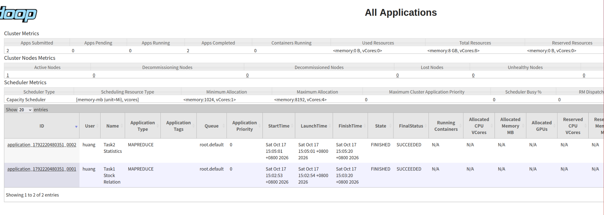
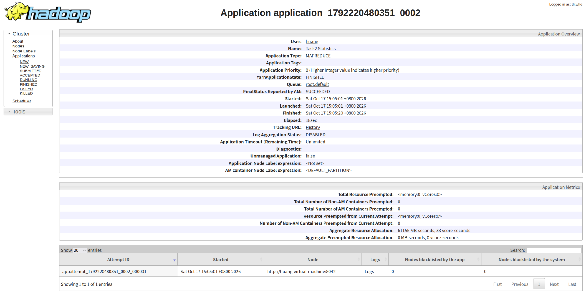
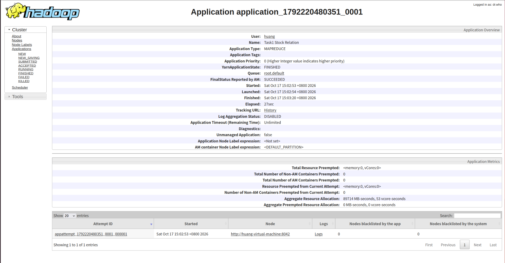

# Hadoop Assignment 5

## 1. 作业目标

使用 Hadoop MapReduce 对 A.txt 和 B.txt 中的股票成分数据进行集合关系分析，并完成二次统计。

输入文件中每行格式为：

    指数编号 股票代码

本作业完成两个任务：

1. 判断每个指数下股票在 A.txt 和 B.txt 中的集合关系：
   - BOTH：同时出现在 A 和 B 中
   - A_ONLY：只出现在 A 中
   - B_ONLY：只出现在 B 中

2. 对任务 1 的结果进行统计，计算每个指数下：
   - 交集数量
   - A 独有数量
   - B 独有数量
   - 并集数量

---

## 2. 项目结构

    assignment5/
    ├── input/
    │   ├── A.txt
    │   └── B.txt
    ├── output/
    │   ├── output_task1/
    │   │   └── part-r-00000
    │   └── output_task2/
    │       └── part-r-00000
    ├── screenshots/
    │   ├── yarn_overview.png
    │   ├── task1_success.png
    │   └── task2_success.png
    ├── src/
    │   └── main/
    │       └── java/
    │           └── com/
    │               └── assignment5/
    │                   ├── Task1.java
    │                   └── Task2.java
    ├── target/
    │   └── assignment5-1.0-SNAPSHOT.jar
    ├── pom.xml
    ├── .gitignore
    └── README.md

---

## 3. 设计思路

### 3.1 Task 1：集合关系判断

Task 1 同时读取 A.txt 和 B.txt。

Mapper 根据输入文件名判断当前记录来自 A 还是 B，并以“指数编号 + 股票代码”作为 key，以来源标记 A 或 B 作为 value。

Reducer 对同一个 key 的所有 value 进行汇总：

- 同时出现 A 和 B：输出 BOTH
- 只出现 A：输出 A_ONLY
- 只出现 B：输出 B_ONLY

由于 Reducer 只判断是否出现过 A 或 B，因此即使同一股票在同一文件中重复出现，也只会计算一次。

### 3.2 Task 2：统计结果

Task 2 读取 Task 1 的输出结果。

Mapper 以指数编号作为 key，以 BOTH、A_ONLY 或 B_ONLY 作为 value。

Reducer 分别统计三类关系数量，并计算：

    并集数量 = BOTH + A_ONLY + B_ONLY

---

## 4. 编译

使用 Maven 编译：

    mvn clean package

编译成功后生成：

    target/assignment5-1.0-SNAPSHOT.jar

---

## 5. Hadoop 运行命令

### 5.1 上传输入文件

    hdfs dfs -mkdir -p /assignment5/input
    hdfs dfs -put input/A.txt /assignment5/input/
    hdfs dfs -put input/B.txt /assignment5/input/

### 5.2 运行 Task 1

    hadoop jar target/assignment5-1.0-SNAPSHOT.jar \
    com.assignment5.Task1 \
    /assignment5/input/A.txt \
    /assignment5/input/B.txt \
    /assignment5/output_task1

### 5.3 运行 Task 2

    hadoop jar target/assignment5-1.0-SNAPSHOT.jar \
    com.assignment5.Task2 \
    /assignment5/output_task1 \
    /assignment5/output_task2

---

## 6. 运行结果

### 6.1 Task 1

Task 1 输出每个指数编号、股票代码以及对应的集合关系。

例如：

    101    AAPL    A_ONLY
    101    JPM     BOTH
    101    KO      B_ONLY
    101    UNH     BOTH
    101    V       BOTH

完整结果保存在：

    output/output_task1/part-r-00000

### 6.2 Task 2

Task 2 最终统计结果为：

    101    3     13    4      20
    102    3     19    3      25
    103    52    195   255    502

各列依次表示：

    指数编号  交集数量  A独有数量  B独有数量  并集数量

完整结果保存在：

    output/output_task2/part-r-00000

---

## 7. YARN 运行结果

两个 MapReduce 任务均在 YARN 中成功运行，状态均为 FINISHED，最终状态均为 SUCCEEDED。

### 7.1 YARN 应用总览

### 7.2 Task 1 运行成功

### 7.3 Task 2 运行成功

---

## 8. 不足与改进

当前程序采用单 Reducer，以保证输出结果按照指数编号和股票代码有序。

对于本次作业的数据规模，这种方式实现简单，并且可以直接满足输出顺序要求。

但在更大规模的数据场景下，单 Reducer 可能成为性能瓶颈，限制任务的并行处理能力。

后续可以考虑使用多个 Reducer，并结合自定义 Partitioner 和全局排序机制，在保证输出顺序的同时提高程序的并行度和扩展性。
